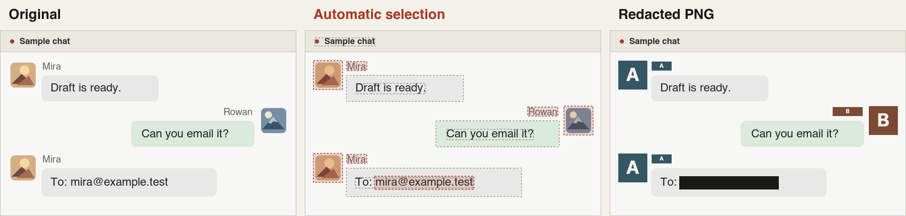

# Screenshot Redactor

**English** · [简体中文](README.zh-CN.md)

**Redact screenshots in your browser without uploading them.** Your screenshots and recognized text stay on your device.

Open a screenshot and the editor automatically selects avatars and likely sensitive text. Review the boxes, adjust them if needed, and export a PNG. [Open Screenshot Redactor](https://ostrovsky2056.github.io/screenshot-redactor/)

## Example

See how the editor selects avatars, nicknames, and an email address in a fictional chat. [Try this example](https://ostrovsky2056.github.io/screenshot-redactor/?example=chat)

## Using the editor

1. Choose, drop, or paste a PNG, JPEG, or WebP screenshot. The editor looks for avatars, faces, and sensitive text in English and Simplified Chinese.
2. Review the dashed boxes. Red boxes are selected for masking. Gray boxes are available to select, and amber boxes flag name boundaries that need a closer look. Click a box to toggle it, drag a corner of a selected box to resize it, or drag elsewhere to add a box. You can undo changes. Clearing the selection keeps the detected boxes available.
3. Choose a mask style and adjust its opacity. Gaussian blur also has a strength control. Mark speakers replaces each recognized speaker’s avatars with a matching illustration generated in the browser. In Speaker avatars, you can assign a PNG, JPEG, or WebP from your device to a speaker or restore their default illustration. Selected names beside avatars are filled with the nearby background color by default. Preview the result, then copy the redacted image or export a PNG at the original dimensions.

Text recognition covers common email addresses, phone numbers, IDs, payment card numbers, credentials, and names. In chat, the editor uses the positions of avatars, bubbles, and text to find speakers. It looks for names and nicknames inside messages and quoted replies and masks the recognized names. Review and adjust suggestions before export.

## On-device processing

Images, recognized text, and mask regions are processed in browser memory. On the first scan, the browser loads the models and WebAssembly files from this site. Masks are rendered directly into the copied or exported PNG. Blur and lower opacity can leave details from the original visible.

For mixed-language chat text and uncertain name boundaries, Tesseract.js reads selected lines again from crops of the original image. The editor aligns the name to the new character boxes when it can verify the range.

If the first pass misses a highlighted mention, the editor can read the highlight on its own and mask the nickname. Chat layout also helps recover repeated avatars from their visible portion and keeps avatar boxes consistent in the same screenshot.

## Local development

Run `python3 -m http.server 8000` from the repository root and open `http://127.0.0.1:8000/`. GitHub Pages deploys the static site from the root of the `main` branch.

The editor follows the browser’s language for English and Simplified Chinese. English is used when a translation is unavailable. Changing the language manually saves the language preference.

A small local chat-layout model scores avatar and message-bubble pairs using surface color, edge positions, spacing, and where OCR found text. It is trained on generated layouts. Run `node scripts/train-chat-layout.cjs` to regenerate its weights and `node --test` to run the tests.

## License

The project uses the MIT license. Barlow Condensed uses the SIL Open Font License. [Project license](LICENSE) · [Font license](assets/barlow-condensed-ofl.txt)

- OCR uses Tesseract.js 6.0.1, Tesseract.js Core 6.0.0, and the English and Simplified Chinese tessdata_fast 4.1.0 models. [Tesseract.js](https://github.com/naptha/tesseract.js/tree/v6.0.1) · [Models](https://github.com/tesseract-ocr/tessdata_fast/tree/4.1.0) · [Licenses](assets/ocr)
- Face detection uses MediaPipe Tasks Vision 0.10.21 and BlazeFace Short Range v1. [MediaPipe](https://github.com/google-ai-edge/mediapipe/tree/v0.10.21) · [Model card](https://huggingface.co/litert-community/MediaPipe-FaceDetector-BlazeFace-Short-Range) · [License](assets/vision/LICENSE)
