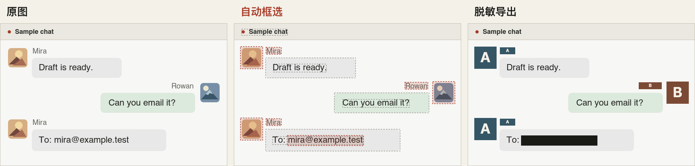

# 截图脱敏

[English](README.md) · **简体中文**

**全程在浏览器本地处理，无需上传截图。** 截图和识别出的文字始终留在你的设备上。

打开一张截图，工具会自动框选头像和疑似敏感文字。核对框选，按需调整，即可导出脱敏 PNG。[在线使用](https://ostrovsky2056.github.io/screenshot-redactor/)

## 试用示例

这段虚构聊天展示了头像、昵称和邮箱从自动框选到脱敏导出的效果。[一键试用示例](https://ostrovsky2056.github.io/screenshot-redactor/?example=chat)

## 使用方法

1. 选择、拖入或粘贴一张 PNG、JPEG 或 WebP 截图。编辑器会查找头像、人脸和中英文敏感文字。
2. 核对虚线框。朱红色表示已选中遮挡，灰色表示可选。点按任一框可切换选择，拖动可补画，也可以撤销。清空遮挡后，识别出的框仍可点击。
3. 预览遮挡并导出与原图同尺寸的 PNG。识别出聊天发言人时，默认让同一人的头像、昵称和能对应的引用署名使用同一种颜色和字母代号。也可选择墨黑、纸白或像素纹理。

文字识别覆盖常见邮箱、电话号码、身份证号、银行卡号、密钥和姓名。编辑器会结合头像、气泡和文字的位置识别聊天发言人，也会在正文及引用回复中查找人名、昵称和称呼。识别到的人名单独框选，导出前可点击或拖动修正。

## 本地处理

图片、识别出的文字和遮挡区域都在当前浏览器的内存中处理。首次扫描时，浏览器从本站加载模型和 WebAssembly 文件。导出时用生成的不透明颜色覆盖选中的区域，像素纹理也由这些颜色组成。

## 本地开发

在仓库根目录运行 `python3 -m http.server 8000`，然后打开 `http://127.0.0.1:8000/`。GitHub Pages 从 `main` 分支根目录部署静态站点。

编辑器跟随浏览器使用英语或简体中文，缺少翻译时回退到英语。手动切换语言会保存语言偏好。

聊天布局使用小型本地模型，根据色块、边缘位置、间距和 OCR 的文字分布给头像与气泡的配对打分。模型使用程序生成的布局样本训练。运行 `node scripts/train-chat-layout.cjs` 可重新生成模型权重。运行 `node --test tests/*.test.cjs` 可验证头像、发言人、引用和正文名字的框选。

## 许可证

项目采用 MIT 许可证，Barlow Condensed 字体采用 SIL Open Font License。[项目许可](LICENSE) · [字体许可](assets/barlow-condensed-ofl.txt)

- OCR 使用 Tesseract.js 6.0.1、Tesseract.js Core 6.0.0 和 tessdata_fast 4.1.0 的英语及简体中文模型。[Tesseract.js](https://github.com/naptha/tesseract.js/tree/v6.0.1) · [模型](https://github.com/tesseract-ocr/tessdata_fast/tree/4.1.0) · [许可证](assets/ocr)
- 人脸检测使用 MediaPipe Tasks Vision 0.10.21 与 BlazeFace Short Range v1。[MediaPipe](https://github.com/google-ai-edge/mediapipe/tree/v0.10.21) · [模型卡](https://huggingface.co/litert-community/MediaPipe-FaceDetector-BlazeFace-Short-Range) · [许可证](assets/vision/LICENSE)
